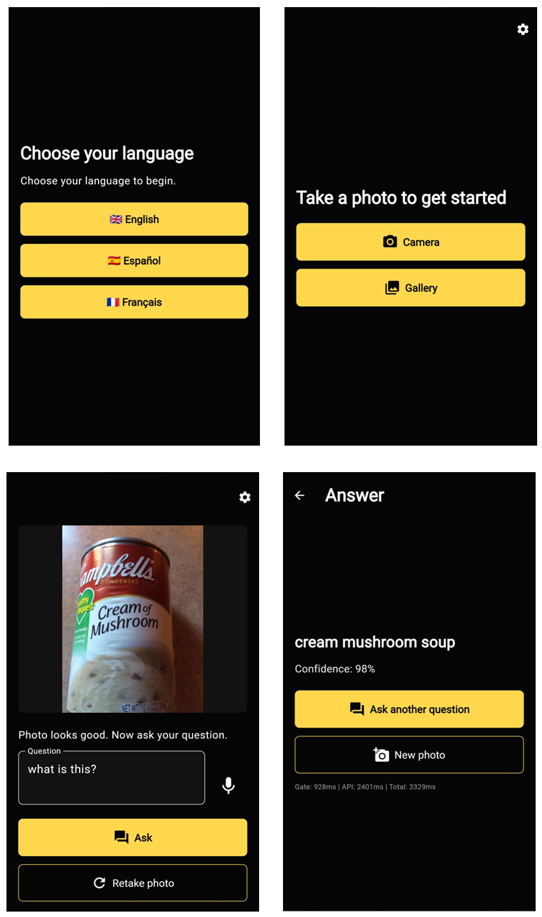
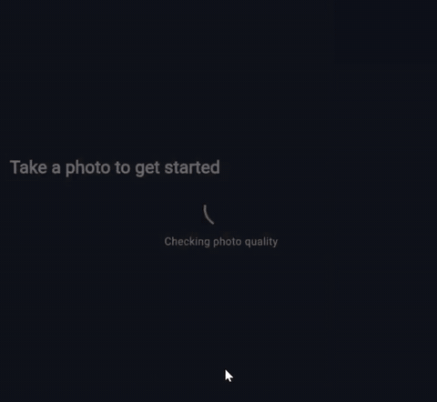
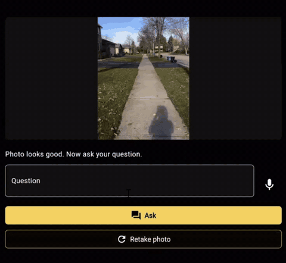
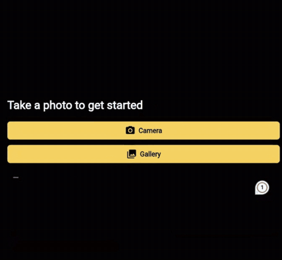
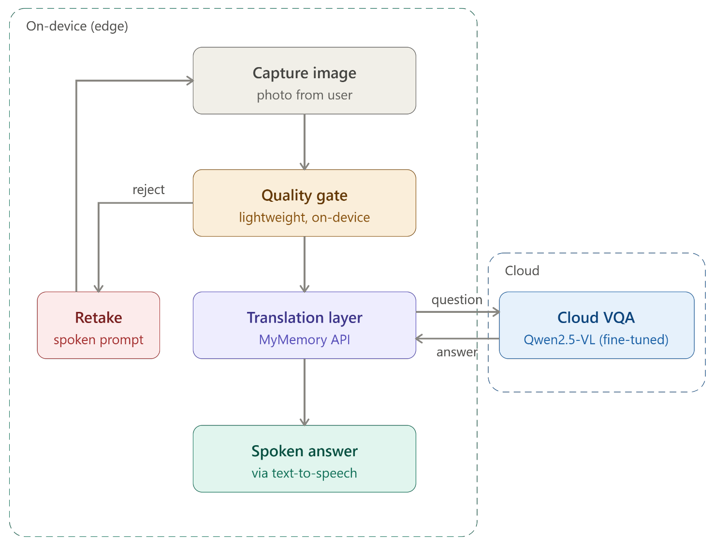
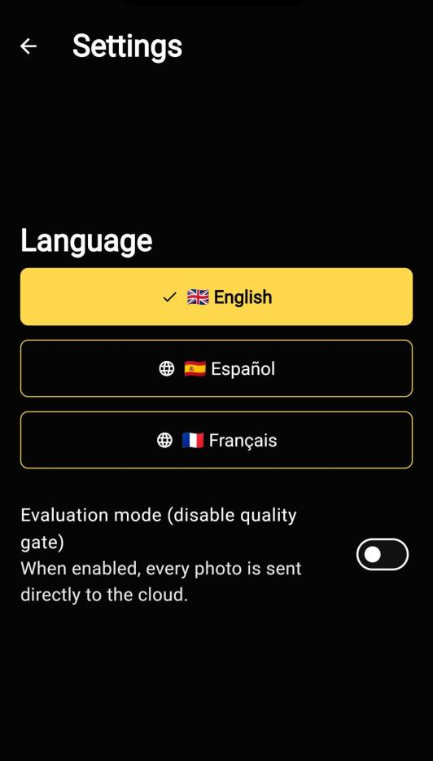
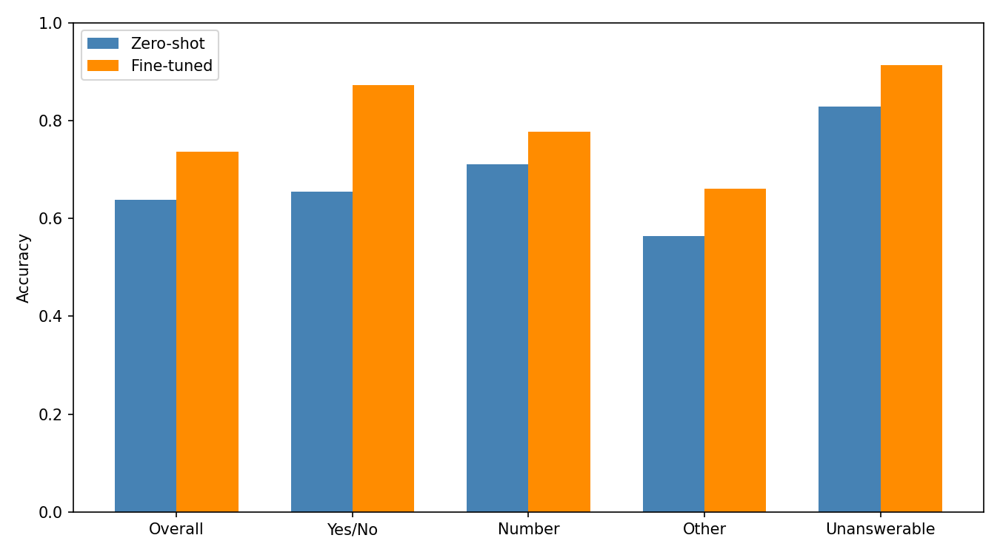
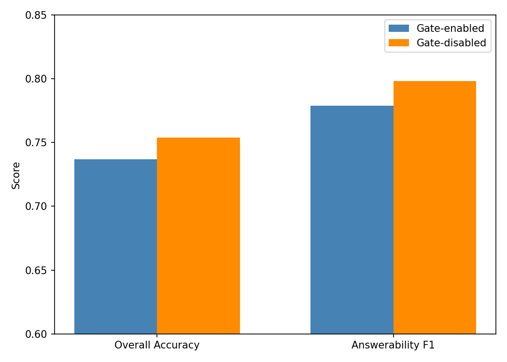
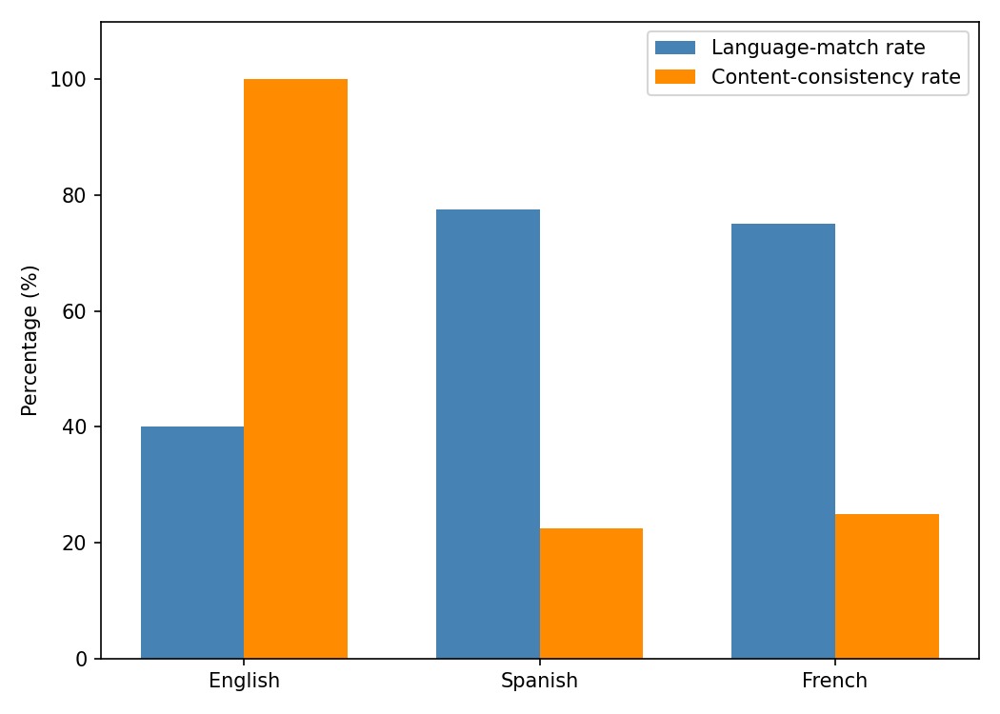

# Quality-Gated Visual Question Answering for Visually Impaired People

A hybrid edge-cloud mobile web assistant that lets visually impaired people (VIP) take a photo, ask a question about it by voice or text, and hear the answer spoken aloud.

Photos taken by blind and low-vision users are often blurry, too dark, or too bright. Most assistive VQA tools still send these photos to the cloud and return a confident but wrong answer instead of asking the user to try again.

This project places a deterministic, learning-free **quality gate** on the device, in front of the model. Unusable photos are caught in the browser and the user is asked, by voice, to retake them. Usable photos are answered by a **Qwen2.5-VL-3B-Instruct** model fine-tuned on VizWiz-VQA with QLoRA and served from the cloud.

The app is built with Flutter Web, opens straight from a QR code with nothing to install, and supports English, Spanish, and French.

This repository accompanies my MSc Data Science and Artificial Intelligence dissertation at Bournemouth University.

---

## App Preview

<p align="center">
  
</p>

The four main screens of the app: language selection (top left), capture (top right), question input after the photo passes the quality gate (bottom left), and the spoken answer with confidence and processing time (bottom right).

---

## Demo GIFs

Short clips from the live demonstration in my project presentation.

### Example 1: Quality Gate Rejects Unusable Photos

<p align="center">
  
</p>

A blurry, an bright, and a dark photo are each caught on the device before any cloud request, and the user is told how to fix the problem.

---

### Example 2: Ask a Question

<p align="center">
  
</p>

A usable photo passes the gate. The user asks "where am I", and the model answers "sidewalk" with 91% confidence.

---

### Example 3: Ask in Spanish

<p align="center">
  
</p>

The user switches the language to Spanish and asks a question in Spanish. The question is translated to English for the model, and the answer comes back in Spanish as "vereda" (sidewalk) with 94% confidence.

---

## What This Project Does

The assistant connects four layers:

1. **Capture**  
   The user takes a photo with the phone camera or picks one from the gallery.

2. **On-device quality screening**  
   The photo is checked for blur, darkness, and overexposure in the browser. If it is unusable, the user hears a prompt such as:

   ```text
   The photo is too blurry. Please hold steady and try again.
   ```

3. **Cloud visual question answering**  
   The user asks a question by voice or text. The photo and question are sent to the fine-tuned Qwen2.5-VL model, which returns a short answer, or `unanswerable` when the photo does not contain enough information.

4. **Multilingual spoken answer**  
   Questions in Spanish or French are translated to English before inference, and the answer is translated back and read aloud.

The project is built around three research questions:

- **RQ1:** Does a deterministic, learning-free on-device image-quality gate improve the reliability and efficiency of cloud-based VQA for VIP?
- **RQ2:** Does domain-specific fine-tuning on VizWiz-VQA improve answer accuracy and answerability detection compared to zero-shot inference?
- **RQ3:** Can a hybrid edge-cloud VQA assistant with multilingual voice interaction be effectively deployed on mobile devices?

---

## System Architecture

<p align="center">
  
</p>

This diagram shows how computation is split between the device and the cloud. The device handles everything that is cheap and deterministic: capture, quality screening, translation calls, and audio. The cloud runs only the 3-billion-parameter model.

```text
Capture image
     |
     v
Quality gate (on-device) ──reject──> Spoken retake prompt ──> Capture image
     |
   pass
     v
Translate question to English (if needed)
     |
     v
Netlify Function (adds token server-side)
     |
     v
Fine-tuned Qwen2.5-VL-3B on Hugging Face Inference Endpoint
     |
     v
Translate answer back (if needed)
     |
     v
Spoken answer (ElevenLabs, fallback: Web Speech API)
```

API keys never reach the browser. Calls to the model and to text-to-speech go through two small Netlify Functions that add the credentials on the server. All traffic is over HTTPS and no images are stored after inference.

---

## On-Device Quality Gate

The gate is written in Dart and runs entirely in the browser, off the main thread, before any network call. Each photo is resized to 640 px on its longest side and converted to grayscale, matching the calibration preprocessing. A photo is rejected if **any** check fails:

| Check | Metric | Threshold |
|---|---|---|
| Too blurry | Laplacian variance | < 100.0 |
| Too dark | Mean grayscale brightness | < 34.0 |
| Too bright | Fraction of pixels ≥ 245 | > 23.12% |

The thresholds were calibrated against the **VizWiz-QualityIssues** dataset (31,181 labelled images). The Dart implementation was verified to produce the same metric values as the Python calibration, since any difference would invalidate the thresholds.

**Per-metric calibration results**

| Metric | Precision | Recall | F1 |
|---|---|---|---|
| Blur | 0.474 | 0.623 | 0.538 |
| Dark | 0.796 | 0.596 | 0.682 |
| Bright | 0.380 | 0.350 | 0.370 |

**Combined gate (OR logic)**

| Precision | Recall | F1 | False rejection rate | Overall rejection rate |
|---|---|---|---|---|
| 0.529 | 0.640 | 0.580 | 0.270 | 0.389 |

For calibration details, see [`Quality_Gate_Calibration/`](Quality_Gate_Calibration/).

---

## Cloud VQA Model

**Qwen2.5-VL-3B-Instruct** was fine-tuned on the gate-passed subset of VizWiz-VQA with QLoRA on a single Colab GPU.

| Hyperparameter | Value |
|---|---|
| Quantisation | 4-bit NF4, double quantisation, bfloat16 compute |
| LoRA rank / alpha / dropout | 16 / 32 / 0.05 |
| Target modules | `q_proj`, `k_proj`, `v_proj`, `o_proj` (vision encoder frozen) |
| Trainable parameters | 7.4M (0.36% of total) |
| Learning rate | 1 × 10⁻⁴ |
| Epochs | 2 |
| Effective batch size | 16 (batch 1 × gradient accumulation 16) |
| Optimiser | `paged_adamw_8bit`, 100 warmup steps |

**Training data:** VizWiz-VQA questions whose images passed the quality gate, labelled with the majority answer from 10 crowdsourced answers. `unanswerable` is kept as a valid target so the model learns to abstain.

| Split | Before gate | After gate | Retained |
|---|---|---|---|
| Train | 20,523 | 12,583 | 61.3% |
| Validation | 4,319 | 2,622 | 60.7% |

After training, the LoRA adapters were merged into the base weights and the model was deployed as a private Hugging Face Inference Endpoint. The custom endpoint handler ([`handler.py`](Training_and_Evaluation/handler.py)) takes a base64 image and a question and returns the answer with a confidence score.

For the full pipeline, see [`Training_and_Evaluation/Qwen_Finetuned.ipynb`](Training_and_Evaluation/Qwen_Finetuned.ipynb).

---

## Flutter Web Application

<p align="center">
  
</p>

This figure shows the settings menu, where users can change their language and switch on **evaluation mode**. Evaluation mode turns the quality gate off and sends every photo directly to the cloud, which enables the gate-enabled vs gate-disabled comparison.

The app is designed so that no step relies on sight alone:

- dark high-contrast theme and large touch targets,
- screen-reader labels on every control,
- spoken cues at every screen change,
- spoken retake prompts when a photo is rejected,
- answers read aloud via ElevenLabs, with automatic fallback to the browser's built-in speech.

Voice input uses the Web Speech API, which works in browsers such as Chrome for Android. On browsers without it, such as Safari on iOS, users can dictate with the keyboard's microphone key or type instead.

---

## Example Interaction

```text
User:
[takes a photo of a soup can]
```

Quality gate:

```text
Photo looks good. Now ask your question.
```

```text
User:
What is this?
```

Request sent from the app to the VQA function:

```json
{
  "image": "<base64-encoded photo>",
  "question": "what is this?"
}
```

Model response:

```json
{
  "answer": "cream mushroom soup",
  "confidence": 0.98
}
```

The answer is read aloud, and the answer screen shows the confidence and the time spent in the gate and the API. This is the interaction shown in the bottom row of the [App Preview](#app-preview).

---

## Key Features

- Deterministic, learning-free on-device quality gate (blur, dark, bright)
- Thresholds calibrated on VizWiz-QualityIssues
- Spoken retake prompts, so recovery does not rely on sight
- Qwen2.5-VL-3B-Instruct fine-tuned with QLoRA on VizWiz-VQA
- `unanswerable` detection, so the model can abstain
- Hybrid edge-cloud design with API keys kept server-side
- English, Spanish, and French interface with translation layer
- Voice or text questions, spoken answers
- Opens from a QR code in the browser, with nothing to install
- Evaluation mode for gate-enabled vs gate-disabled testing

---

## Evaluation

The system was evaluated on VizWiz-VQA for model accuracy, system reliability and latency, and cross-lingual behaviour.

### Model Performance (RQ2)

Zero-shot vs fine-tuned model on the gate-passed validation set (N = 2,622):

<p align="center">
  
</p>

| Metric | Zero-shot | Fine-tuned | Δ |
|---|---|---|---|
| Overall accuracy | 0.638 | 0.737 | **+0.099** |
| Yes/No accuracy | 0.655 | 0.872 | **+0.217** |
| Number accuracy | 0.711 | 0.778 | +0.067 |
| Other accuracy | 0.564 | 0.661 | +0.098 |
| Unanswerable accuracy | 0.829 | 0.914 | +0.084 |
| Answerability precision | 0.633 | 0.750 | +0.117 |
| Answerability recall | 0.769 | 0.809 | +0.040 |
| Answerability F1 | 0.695 | 0.779 | **+0.084** |

Fine-tuning improved every answer category. The gain in unanswerable accuracy shows that the model learned to abstain when it cannot read an image.

---

### System Performance (RQ1)

Fine-tuned model with the gate enabled vs disabled:

<p align="center">
  
</p>

| Metric | Gate-enabled (N = 2,622) | Gate-disabled (N = 4,319) | Δ |
|---|---|---|---|
| Overall accuracy | 0.737 | 0.754 | −0.016 |
| Answerability F1 | 0.779 | 0.798 | −0.019 |

The gate does **not** raise offline accuracy. The rejected photos include many `unanswerable` images that the model already handles well, so removing them leaves a harder set of answerable photos. The gate's value is in how the system behaves: it stops unusable photos before they cost a cloud request and immediately tells the user, by voice, to retake.

**End-to-end latency** in the deployed app (10 trials, ms):

| Condition | Gate | API | Total (mean) |
|---|---|---|---|
| Gate-enabled | 261.2 | 1191.5 | **1450.1** |
| Gate-disabled | 0 | 1214.3 | 1214.3 |

The gate adds about a quarter of a second and the total response stays under 1.5 seconds.

---

### Cross-Lingual Verification (RQ3)

Language-match and content-consistency rates, measured **without** the translation layer (N = 40 per language):

<p align="center">
  
</p>

| Language | Language-match rate | Content-consistency rate |
|---|---|---|
| English | 40.0% | 100.0% (reference) |
| Spanish | 77.5% | 22.5% |
| French | 75.0% | 25.0% |

Because the model was fine-tuned only in English, it drifts between languages. This is why the deployed app translates questions to English and answers back to the user's language, which gives answers in the chosen language for all three languages.

---

## Key Findings

- Fine-tuning improved overall accuracy by **9.9 points** and answerability F1 by **8.4 points** over the zero-shot baseline, with the largest gain on yes/no questions (**+21.7 points**).
- The quality gate did not improve offline accuracy, but it stops unusable photos before they reach the cloud and guides the user to retake them, while keeping the total response time under **1.5 seconds**.
- The full workflow runs on mobile devices from a browser and a QR code. English-only fine-tuning caused language drift, which the translation layer mitigates.

---

## Limitations

- **Language drift:** fine-tuning was English-only, so Spanish and French rely on a translation layer.
- **Gate coverage:** the gate detects blur, darkness, and overexposure, but not framing errors, finger occlusion, or cropped subjects.
- **Static thresholds:** thresholds were calibrated once on a single dataset and do not adapt to device or lighting.
- **False rejections:** 27% of good photos are rejected, a deliberate trade-off for higher recall of bad photos.
- **Evaluation scope:** results come from an offline benchmark, not live use by visually impaired participants. The cross-lingual set is limited to 40 manually translated examples.
- **Ephemeral endpoint:** the model endpoint is paused when not in use, so answers only return while it is running.

---

## Future Work

| Direction | Description |
|---|---|
| Multilingual fine-tuning | Fine-tune on Spanish and French data to fix the root cause of language drift instead of relying on translation |
| Live user evaluation | Study visually impaired participants using the app end to end, including how they respond to retake prompts |
| Broader quality detection | Extend the gate to framing, occlusion, and off-centre or cropped subjects |
| Adaptive thresholds | Thresholds that adjust to device, lighting, or user behaviour while staying learning-free and on-device |

---

## Repository Structure

```text
vip-vqa-assistant/
│
├── README.md
│
├── media/
│   ├── app_screens.png           # main app screens
│   ├── settings_screen.png       # settings menu
│   ├── system_architecture.png   # system architecture diagram
│   │
│   └── demos/
│       ├── demo_quality_gate.gif
│       ├── demo_ask_question.gif
│       └── demo_spanish.gif
│
├── Quality_Gate_Calibration/
│   ├── Vizwiz_Quality_Gate_Calibration.ipynb   # blur / dark / bright threshold calibration
│   └── calibrate_blur_threshold.py             # Laplacian variance threshold sweep
│
├── Training_and_Evaluation/
│   ├── Qwen_Finetuned.ipynb      # QLoRA fine-tuning, zero-shot / fine-tuned / gate-disabled / cross-lingual evaluation
│   ├── handler.py                # Hugging Face Inference Endpoint handler
│   ├── requirements.txt          # endpoint dependencies
│   └── results/                  # scores, cross-lingual results and figures
│
└── VIP_Assistant/                # Flutter Web application
    ├── lib/
    │   ├── app/                  # GetX routes, dark high-contrast theme
    │   ├── controllers/          # capture, gate, language, question, settings, vqa
    │   ├── models/               # gate result, VQA answer
    │   ├── screens/              # language select, home, processing, retake, answer, settings
    │   ├── services/             # quality gate, speech, translation, TTS, VQA API
    │   ├── constants.dart        # thresholds, constants, localized strings
    │   └── main.dart             # entry point, dependency injection
    ├── web/                      # index.html (speech and audio JS interop), manifest.json
    ├── netlify/functions/        # vqa.js and tts.js, keep API keys server-side
    ├── netlify.toml
    └── pubspec.yaml
```

---

## Running the App Locally

You'll need:

- Flutter SDK (Dart >= 3.4.0 < 4.0.0) with web support
- Node.js (provides npm)
- Netlify CLI: `npm install -g netlify-cli`

Both the model call and text-to-speech go through Netlify Functions, so a plain `flutter run` can't reach them. Use `netlify dev`, which serves the app and the functions together.

1. Open a terminal inside the `VIP_Assistant` folder (where `pubspec.yaml` lives).

2. Create a `.env` file there with your own keys:

   ```bash
   HF_TOKEN=your_hugging_face_token
   ELEVENLABS_API_KEY=your_elevenlabs_key
   ```

   - `HF_TOKEN`: used by `vqa.js` to call the authenticated model endpoint. Any valid token from [huggingface.co/settings/tokens](https://huggingface.co/settings/tokens) works.
   - `ELEVENLABS_API_KEY`: used by `tts.js` for natural speech. Get one from [elevenlabs.io](https://elevenlabs.io/app/developers/api-keys). Without it, the app falls back to the browser's Web Speech API.

3. Install dependencies and run:

   ```bash
   flutter pub get
   flutter build web
   netlify dev
   ```

   On first use, `netlify dev` may ask you to run `netlify login`. It reads `.env` automatically and opens the app in your browser.

A full VQA answer also requires the Hugging Face Inference Endpoint to be running. If it is paused, it must be redeployed and `kHfEndpointUrl` in `VIP_Assistant/lib/constants.dart` updated.

The deployed site was published with `flutter build web` followed by `netlify deploy --dir=build/web --prod`, with both keys set as environment variables in the Netlify dashboard.

---

## Data

The VizWiz datasets are not included in this repository because of their size and licence terms. They can be downloaded from the official source:

- **VizWiz-VQA:** questions and images used for fine-tuning and evaluation
- **VizWiz-QualityIssues:** quality annotations used to calibrate the gate

Both are available at [vizwiz.org](https://vizwiz.org/tasks-and-datasets/vqa/).

---

## Ethics and Privacy

Photos live only in browser memory for the length of a session; nothing is written to disk, storage, or logs. Images (and, for non-English users, question and answer text) are sent over HTTPS to the third-party services above only for processing; what they retain is governed by their own privacy policies. The app is an assistive aid, not a replacement for human judgement.

---

## Project Status

```text
Quality gate calibrated on VizWiz-QualityIssues
Qwen2.5-VL-3B-Instruct fine-tuned with QLoRA on VizWiz-VQA
Model deployed as a Hugging Face Inference Endpoint
Flutter Web app deployed on Netlify and tested on mobile devices
Gate-enabled vs gate-disabled and cross-lingual evaluations completed
Future work: multilingual fine-tuning and live user evaluation
```

---

## Author

**Damla Su Yayla**  
MSc Data Science and Artificial Intelligence, Bournemouth University  
London, United Kingdom

GitHub: [github.com/DamlaSuYayla](https://github.com/DamlaSuYayla)  
LinkedIn: [linkedin.com/in/damla-su-yayla-7b495b20a](https://www.linkedin.com/in/damla-su-yayla-7b495b20a)  
Kaggle: [kaggle.com/damlasuyayla](https://www.kaggle.com/damlasuyayla)
